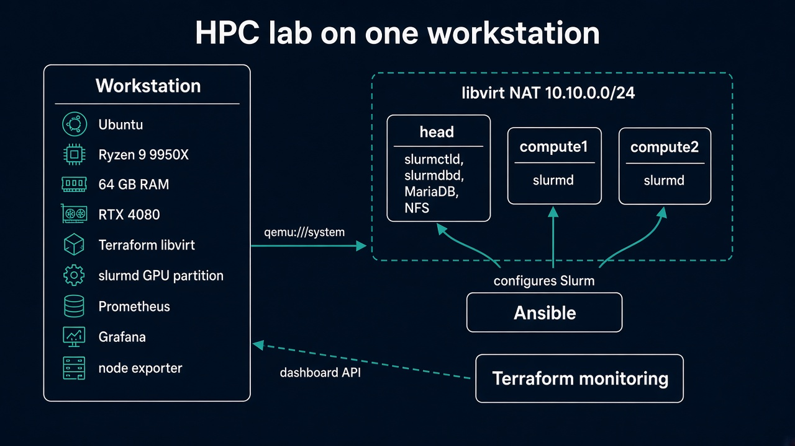
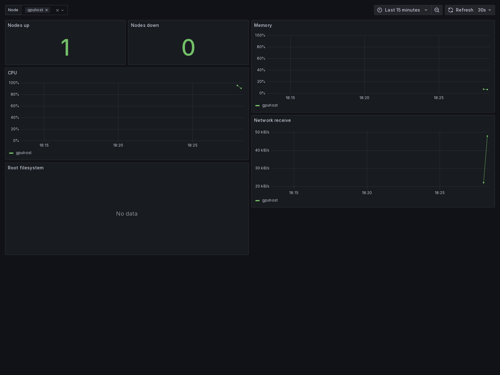

# HPC lab on one workstation

This repo builds a small Slurm site on a single Ubuntu workstation. Terraform creates the KVM virtual machines. Ansible installs Slurm, NFS, and the metrics agents. A second Terraform state logs into Grafana and creates the dashboard.

The GPU stays on the workstation. CPU jobs run on the virtual machines. GPU jobs run on the host, so the RTX 4080 does not have to be passed through to a guest.



## What you get

```text
workstation
  Terraform (libvirt)  ->  KVM guests
  slurmd               ->  Slurm partition gpu, RTX 4080
  Prometheus + Grafana ->  scrape node exporters, dashboard from Terraform
  node exporter

libvirt NAT 10.10.0.0/24
  head       slurmctld, slurmdbd, MariaDB, NFS, node exporter
  compute1   slurmd, node exporter
  compute2   slurmd, node exporter
```

The guests are Ubuntu 26.04 cloud images, so their Slurm packages match an Ubuntu workstation. Ansible does not rename the workstation. Slurm calls that machine `gpuhost` and reaches it at the libvirt gateway `10.10.0.1`.

Sized for a 16-core / 64 GB machine with about 177 GB free:

| Node | vCPU | RAM | Disk |
| --- | ---: | ---: | --- |
| head | 2 | 4 GB | 16 GB thin qcow2 |
| each compute node | 4 | 6 GB | 16 GB thin qcow2 |
| workstation | the cores left over | leave at least 24 GB free for GPU jobs | the host disk |

`compute_count` is capped at 4. Two compute nodes use about 16 GB of RAM and 10 vCPUs.

## Repository layout

```text
infra/            VM Terraform state. Pool, network, base image, node module.
modules/vm/       One disk, one cloud-init ISO, one domain.
monitoring/       Grafana Terraform state. Folder, Prometheus datasource, dashboard.
ansible/          Slurm, NFS, Munge, node exporter, Prometheus, Grafana containers.
jobs/             Sample batch scripts.
scripts/prepare-host.sh
docs/images/      Architecture diagram and dashboard capture.
```

Two Terraform states stay separate on purpose. `infra/` can create and destroy VMs without touching Grafana. `monitoring/` can recreate the dashboard without rebuilding the cluster. Both use local state. Do not commit `terraform.tfstate` or `*.tfvars`.

## How the VM Terraform works

Run it on the workstation. The provider connects to local KVM:

```hcl
provider "libvirt" {
  uri = "qemu:///system"
}
```

`infra/main.tf` builds a map called `local.nodes`. The key `head` is always present. `compute1`, `compute2`, and so on come from `var.compute_count`. Those keys are identities. Renaming a key makes Terraform destroy that VM and create a new one.

Three resources exist once for the whole lab:

1. `libvirt_pool.cluster` is the directory `/var/lib/libvirt/hpc-lab`.
2. `libvirt_volume.base` downloads the Ubuntu 26.04 cloud image one time.
3. `libvirt_network.cluster` is a NAT network on `10.10.0.0/24` with DHCP and DNS for `hpc.lab`.

`module.node` is called with `for_each = local.nodes`. Each call creates:

- a thin qcow2 disk backed by the shared image, capped at 16 GB
- a cloud-init ISO that sets the hostname and installs your SSH public key for the user `ubuntu`
- a KVM domain with host-passthrough CPU, a serial console, and VNC bound to `127.0.0.1`

`wait_for_lease = true` holds the apply until DHCP returns an address. That address becomes `module.node["head"].ip` and the other node outputs.

The last resource, `local_file.ansible_inventory`, renders `ansible/inventory.ini` from those addresses. Ansible has no inventory until this apply finishes. The `gpuhost` line in that file is not a VM. It tells Ansible to configure the workstation over a local connection.

`terraform plan` compares the `.tf` files, `terraform.tfstate`, and libvirt. The first apply creates everything. Raising `compute_count` from `0` to `2` plans two new VMs and leaves `head` alone.

The libvirt provider is pinned to `~> 0.8.3`. The 0.9 provider uses a different schema.

Terraform does not install Slurm. Nothing in `infra/` or `modules/vm/` writes `slurm.conf`.

## How Ansible fits in

`ansible/site.yml` runs after the inventory exists:

1. `common` sets VM hostnames and writes `/etc/hosts`.
2. `nfs_server` / `nfs_client` share `/srv/hpc` from the head node, mounted at `/mnt/hpc`.
3. `munge` creates one key on the head node and copies it to every Slurm node.
4. `slurm_controller` installs MariaDB, `slurmdbd`, and `slurmctld` on `head`.
5. `slurm_compute` starts `slurmd` on the compute VMs, partition `cpu`.
6. `slurm_gpu` starts `slurmd` on the workstation, partition `gpu`, with `gres.conf` pointing at `/dev/nvidia0`. It does not change the NVIDIA driver.
7. `node_exporter` installs `prometheus-node-exporter` on every node.
8. `monitoring` starts Prometheus and Grafana with Docker on the workstation. Both containers use the host network. Prometheus scrapes the VMs on `10.10.0.0/24:9100` and the workstation on `127.0.0.1:9100`.

Slurm configuration is rendered from `ansible/roles/slurm_common/templates/slurm.conf.j2`. The GPU line is `ansible/roles/slurm_gpu/templates/gres.conf.j2`.

Set `slurm_db_password` in `ansible/group_vars/controller.yml` before the playbook. Set the same Grafana password, at least 12 characters, in both of these files:

- `ansible/group_vars/gpu.yml`
- `monitoring/terraform.tfvars`

The placeholder `replace-with-a-lab-password` is rejected.

## How the Grafana Terraform works

`monitoring/` does not start containers. Grafana has to be listening on `http://127.0.0.1:3000` first. The Grafana provider then creates:

- folder `HPC lab`
- datasource `Prometheus` at `http://127.0.0.1:9090`, uid `prometheus`
- dashboard `HPC lab nodes` from `monitoring/dashboards/nodes.json`

The dashboard has a node variable and six panels: nodes up, nodes down, CPU, memory, root filesystem, and received network traffic. A later `terraform apply` in `monitoring/` overwrites edits made in the Grafana UI.



The capture above is that dashboard, with only the workstation exporter (`gpuhost`) scraped. The lines are short because the exporter had just started. After `ansible-playbook site.yml`, the same panels include `head` and the compute nodes. The root-filesystem panel fills in once `prometheus-node-exporter` is running on the host filesystem rather than in a container.

## Deploy

Run these on the workstation, in this order. `qemu:///system` is local, so the apply has to happen there.

```bash
cd ~/Documents/hpc-mlops-platform
./scripts/prepare-host.sh
```

`prepare-host.sh` installs the KVM packages if they are missing and creates `/var/lib/libvirt/hpc-lab`. If `virsh -c qemu:///system list --all` says permission denied, log out and SSH back in so the `libvirt` group applies.

```bash
cp infra/terraform.tfvars.example infra/terraform.tfvars
```

Put your SSH public key in `ssh_public_key`. `compute_count = 0` brings up the head node only. `compute_count = 2` also creates `compute1` and `compute2`.

```bash
cd infra
terraform init
terraform plan
terraform apply
terraform output
ssh ubuntu@<head-ip>
```

The first apply downloads the cloud image, about 800 MB, then waits for a DHCP lease. `terraform output` prints `node_ips` and the SSH commands. `ansible/inventory.ini` is written at the end of the apply.

Change the two passwords described above, then:

```bash
cd ~/Documents/hpc-mlops-platform/ansible
ansible-playbook site.yml
cd ../monitoring
cp terraform.tfvars.example terraform.tfvars
# set grafana_admin_password to the same value as group_vars/gpu.yml
terraform init
terraform plan
terraform apply
terraform output dashboard_url
```

Check the cluster:

```bash
sinfo
sbatch ~/Documents/hpc-mlops-platform/jobs/cpu-hello.sbatch
sbatch ~/Documents/hpc-mlops-platform/jobs/gpu-smi.sbatch
sacct
```

`jobs/gpu-torch.sbatch` needs a `python3` environment on the workstation where `torch` can see CUDA. Install that yourself before submitting it.

Grafana is at `http://127.0.0.1:3000` on the workstation. From another machine:

```bash
ssh -L 3000:127.0.0.1:3000 <user>@<workstation>
```

Then open `http://127.0.0.1:3000`.

If Ansible says the inventory could not be parsed, the VM apply has not written `ansible/inventory.ini` yet. If the monitoring apply rejects `grafana_admin_password`, the example placeholder is still in `monitoring/terraform.tfvars`.

## Destroy

Remove the Grafana objects while Grafana is still running, then stop the containers, then destroy the VMs.

```bash
cd ~/Documents/hpc-mlops-platform/monitoring
terraform destroy

cd /opt/hpc-monitoring
docker compose down

cd ~/Documents/hpc-mlops-platform/infra
terraform destroy

sudo systemctl disable --now slurmd
```

`terraform destroy` in `infra/` deletes the VMs, disks, NAT network, and storage pool. It does not uninstall Slurm packages on the workstation, and it does not stop Prometheus or Grafana. `docker compose down` removes those containers. The `slurmd` unit is the GPU partition on the host.

## Limits

State is local. A later stack for k3s, Helm, or MinIO should be another Terraform state, after this lab is up and the disk still has room. The base image download happens on the first VM apply.
